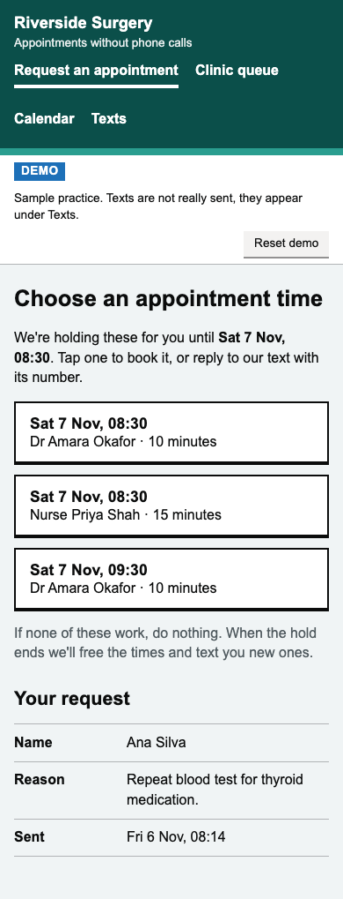
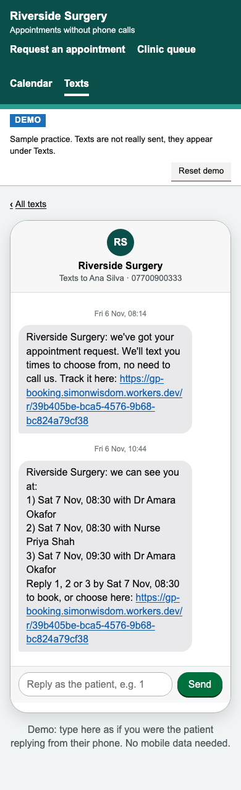
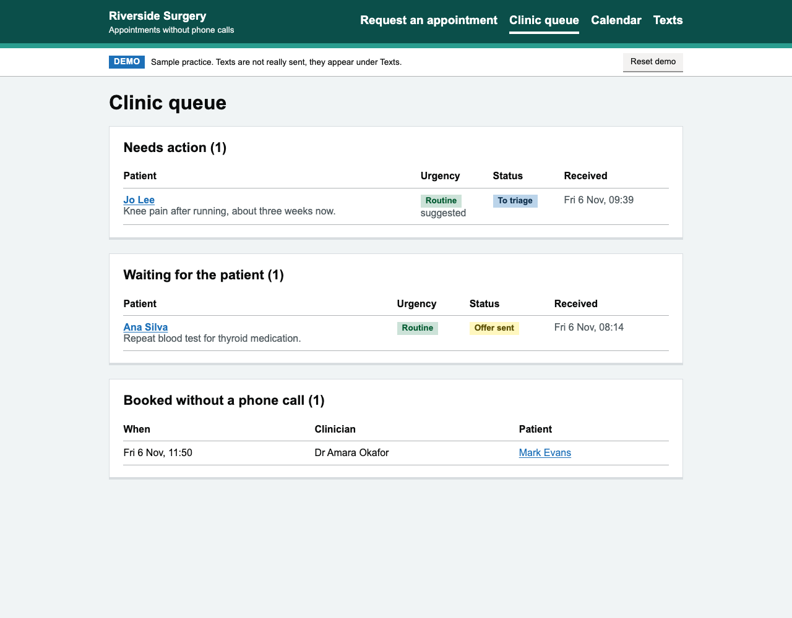
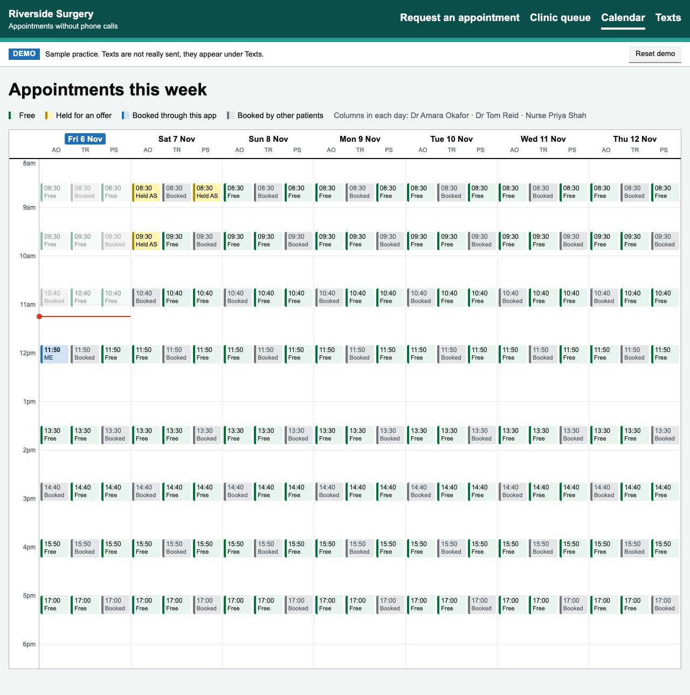

# No-call GP booking

**Live demo:** https://gp-booking.simonwisdom.workers.dev

Patients say when they're free as part of their appointment request. The clinic triages it and texts 2–3 times that fit. The patient taps one, or replies with its number. Nobody has to phone anybody.

<table>
  <tr>
    <td width="50%"></td>
    <td width="50%"></td>
  </tr>
  <tr>
    <td colspan="2"></td>
  </tr>
  <tr>
    <td colspan="2"></td>
  </tr>
</table>

**Why I built this?**

This product idea is based on a recent painful experience I had booking an appointment at my local GP. I entered my details through a web app on my phone, which was fine. What then happened was I had to wait until the next day when they tried to phone me repeatedly while I was at work and I couldn't answer my phone and I missed their calls. I didn't know who the phone was from. It happened the next day, they called about five times and I wasn't able to answer until they sent me a text message saying they were trying to call and they were going to cancel my appointment. I then had to call back and wait for about 20 minutes on hold until I got to someone to schedule an appointment.

**The pain point:** booking by call-back fails both sides. Patients miss calls from unknown numbers while they're at work, risk losing the appointment, and end up on hold. Reception staff spend their day on call-backs that nobody answers.

**The value:** the patient gives their availability once, up front. The practice sends times that already fit, and the patient books whenever suits them, with a tap or a one-digit text. Urgent requests reach the top of the queue, and a person always confirms them. Unanswered offers release their slots automatically, so no time sits held and wasted.

**Who pays?**
This would be licenced to medical clinics, either through the NHS or directly to private clinics.

**Pricing**
Subscription - based on number of doctors and/or number of appointments, or a flat monthly fee.

**Scope**
- Clinic side: triage patient requests, book appointments
- Patient side: request an appointment, set availability, book appointments

## In this demo

- **Patient:** asks for an appointment, ticks the mornings and afternoons they're free, and gets a personal link to pick a time.
- **Clinic:** sees a queue with urgent requests first, confirms urgent or routine, and texts up to 3 matching slots. Those slots are held for the patient.
- **No mobile data?** The text lists the times by number. The patient replies "1", "2" or "3" to book.
- **If the patient doesn't reply,** the offer ends after 2 hours if urgent or 24 if routine, or earlier if an offered slot is about to start. The slots are freed and the request goes back in the queue. It is never cancelled.
- **If nothing fits,** the clinic asks for more times and the patient adds them from their link.
- The clinic's calendar is sample data. Texts aren't really sent: they appear under **Texts**. There's no login.

## Try it (2 minutes)

1. **Clinic** → *Mark Evans* → **Urgent** → **Text these times**.
2. **Texts** → *Mark Evans* → type **1** in the reply box. You're booked by text, and **Calendar** shows the slot taken. (Or tap the link and pick on the web.)
3. **Clinic** → *Jo Lee* → **Routine** → send → **Demo: end this offer now**. She's back in the queue as "No reply".
4. **Patient** → make your own request. **Reset demo** starts over.

## Next steps

- **Clinic sets its own availability:** edit the calendar, or sync it with the practice's clinical system.
- **Manage appointments:** cancel and reschedule, for both the clinic and the patient.
- **Real texts:** send and receive SMS through an SMS provider.
- **Accounts:** patient sign-in (for example NHS login) and staff logins.
- **Reminders** before the appointment.
- **Right clinician for the job:** match the type of clinician to the request, for example a nurse for blood tests.

## How it's built

Cloudflare Workers, D1 (SQLite), Hono, TypeScript. Pages are rendered on the server, with no front-end framework.

- `src/logic.ts`: the rules (urgency, matching slots to free times, expiry, reading text replies), tested in `src/logic.test.ts`.
- `src/db.ts`: every database change. Each one is a single transaction that re-checks the current state, so double clicks or out-of-date pages can't double-book.
- `schema.sql`: the data model: clinicians, slots, requests, availability, offers, texts.

```bash
npm install && npm run db:init:local
npm run dev    # http://127.0.0.1:8787
npm test
npm run deploy # after creating a D1 database and putting its id in wrangler.jsonc
```
